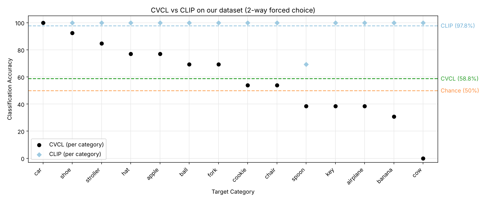

# CLIP vs CVCL — Evaluating Vision-Language Models on Object Recognition


-2ca02c)


> **Multimodal learning · Contrastive vision-language models · Zero-shot classification**
>
> Can a model that learned words from **61 hours of one child's head-camera video** recognise everyday objects as well as a model trained on **400 million internet image–text pairs**?

This repository reproduces, on a small public dataset, the object-recognition comparison (Figure 3A) from:

> Vong, W. K., Wang, W., Orhan, A. E., & Lake, B. M. (2024). **Grounded language acquisition through the eyes and ears of a single child.** *Science*, 383, 504–511. [doi:10.1126/science.adi1374](https://doi.org/10.1126/science.adi1374)

It was done as **Lab 5 of the MLSCO course** (Master 2 IAAA — Artificial Intelligence & Machine Learning, Aix-Marseille Université).

<p align="center">
  
</p>

---

## 🧠 The two models

| | **CLIP** (OpenAI, 2021) | **CVCL** (Vong et al., 2024) |
|---|---|---|
| Training data | 400M+ image–caption pairs scraped from the web | ~61 h of egocentric video + transcribed speech from **one child** (SAYCam-S), age 6–25 months |
| Text supervision | Clean, descriptive captions | Noisy child-directed speech |
| Image encoder | ViT-B/32 | ResNeXt-50 (DINO pre-trained) |
| Objective | Contrastive image–text alignment | Contrastive image–utterance alignment |
| Research goal | Transferable visual representations | Can grounded word learning emerge from a single child's experience? |

Both learn a **shared embedding space**: matching image–text pairs are pulled together, mismatched pairs are pushed apart.

## 🔬 Method

- **Dataset:** 14 everyday objects, one image each — `spoon, hat, apple, shoe, ball, fork, cookie, banana, key, car, airplane, chair, stroller, cow` (course-provided; the paper's evaluation set is not public).
- **Task:** 2-way forced choice. For each target object, the model sees its image and must pick the right word against every other object word as a foil → 13 trials per object, **chance = 50 %**.
- **Pipeline (same for both models):**
  1. **Preprocess** — load image, convert to RGB, resize & normalise, add a batch dimension, move to GPU.
  2. **Encode** — image encoder → image embedding; text encoder → word embeddings.
  3. **Score** — similarity (dot product / cosine) between image and each word; highest score wins.
- **Bonus analysis:** a diagnostic script that lists exactly which foils fool CLIP on *spoon*.

## 📊 Results

| Object | CVCL | CLIP |
|---|---:|---:|
| car | 100.00 % | 100.00 % |
| shoe | 92.31 % | 100.00 % |
| stroller | 84.62 % | 100.00 % |
| hat | 76.92 % | 100.00 % |
| apple | 76.92 % | 100.00 % |
| ball | 69.23 % | 100.00 % |
| fork | 69.23 % | 100.00 % |
| cookie | 53.85 % | 100.00 % |
| chair | 53.85 % | 100.00 % |
| spoon | 38.46 % | **69.23 %** |
| key | 38.46 % | 100.00 % |
| airplane | 38.46 % | 100.00 % |
| banana | 30.77 % | 100.00 % |
| cow | 0.00 % | 100.00 % |
| **Mean** | **58.79 %** | **97.80 %** |

Raw numbers: [`results/per_object_accuracy.csv`](results/per_object_accuracy.csv)

### Key findings

- **CLIP is near ceiling**, as in the paper. Its only weak spot is *spoon* (69 %), confused with *shoe, ball, key* and *car* — most likely because this lab uses ImageNet normalisation and raw dot products instead of CLIP's own preprocessing and cosine similarity.
- **CVCL is well above zero but far below CLIP**, and varies a lot by category — the same pattern as Figure 3A.
- **Agreements with the paper:** *apple* and *hat* rank high, *chair* is mid-range, *airplane, key, spoon* sit at or below chance.
- **Disagreements:** *shoe* (92 % here vs ~chance in the paper), *cookie*, *ball*.

### Why our numbers differ from the paper

1. **Easier task** — 2-way choice (chance 50 %) vs the paper's 4-way choice (chance 25 %).
2. **One image per category** — each score hinges on a single photo's viewpoint, background and style (hence extremes like car 100 % / cow 0 %).
3. **Domain shift** — CVCL saw blurry, cluttered head-cam frames, not clean photos.
4. **The child's vocabulary** — rare words in child-directed speech (*cow, airplane*) get weak embeddings; frequent concrete words (*car, ball, apple*) are learned better.
5. **Small sample, single seed** — 13 trials per object (each error = 7.7 pts), one checkpoint, no error bars vs 3 seeds in the paper.

## 🚀 Run it yourself

The notebook is designed for **Google Colab with a GPU runtime**.

1. Open [`MLSCO_lab5_CLIP_vs_CVCL.ipynb`](MLSCO_lab5_CLIP_vs_CVCL.ipynb) in Colab.
2. Copy the course image folder to your Google Drive as `MyDrive/my_images/` (one `.jpg`/`.png` per object, file name = label).
3. Run all cells. The notebook will:
   - install CLIP: `pip install git+https://github.com/openai/CLIP.git`
   - clone [`wkvong/multimodal-baby`](https://github.com/wkvong/multimodal-baby) and install its requirements
   - download the CVCL checkpoint from Hugging Face (`wkvong/cvcl_s_dino_resnext50_embedding`)

Local install (optional):

```bash
pip install -r requirements.txt
git clone https://github.com/wkvong/multimodal-baby && pip install -r multimodal-baby/requirements.txt
```

> ⚠️ **Compatibility fixes used in the notebook:** `pytorch-lightning==1.9.5`, `huggingface_hub>=1.32,<2.0`, and a small patch forcing `torch.load(weights_only=False)` so the older checkpoints load with recent PyTorch.

## 📁 Repository structure

```
.
├── MLSCO_lab5_CLIP_vs_CVCL.ipynb   # full lab: questions, answers, code & outputs
├── assets/
│   └── clip_vs_cvcl_accuracy.png   # Figure 3A-style comparison plot
├── results/
│   └── per_object_accuracy.csv     # per-object accuracy for both models
├── requirements.txt
├── LICENSE
└── README.md
```

The image dataset is **not included** (course material).

## 🛠️ Tech stack

Python · PyTorch · OpenAI CLIP · PyTorch Lightning · Hugging Face Hub · torchvision · Matplotlib · Google Colab

## 🙏 Acknowledgements

- Wai Keen Vong *et al.* for releasing CVCL and the [`multimodal-baby`](https://github.com/wkvong/multimodal-baby) code.
- OpenAI for [CLIP](https://github.com/openai/CLIP).
- The MLSCO teaching team at Aix-Marseille Université for the lab design and dataset.

## 👤 Author

**Mohamad Al Charif** — M2 IAAA (AI & Machine Learning), Aix-Marseille Université
GitHub: [@hammodesharif-glitch](https://github.com/hammodesharif-glitch)

---

*Licensed under the [MIT License](LICENSE).*
